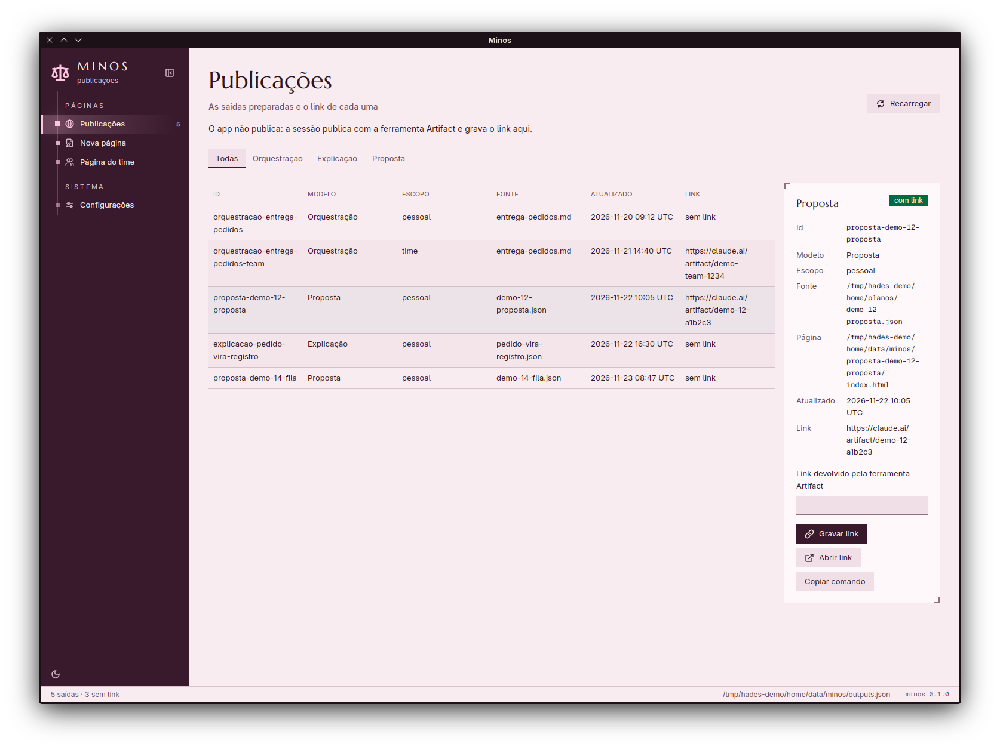
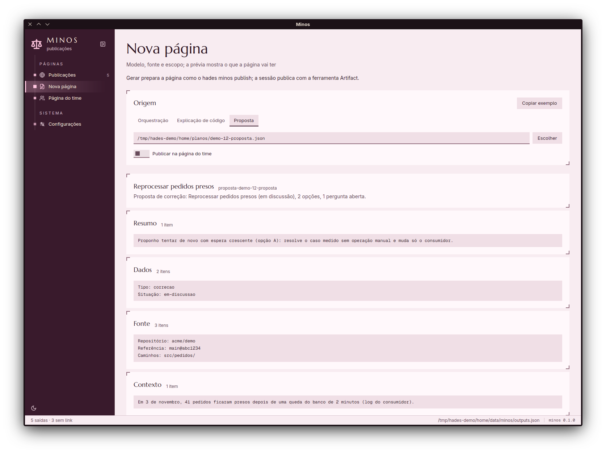
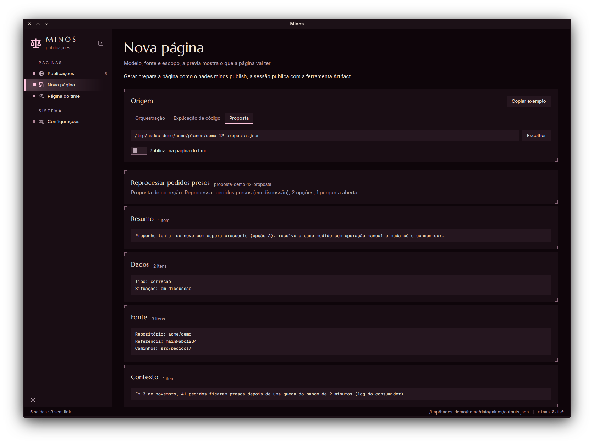
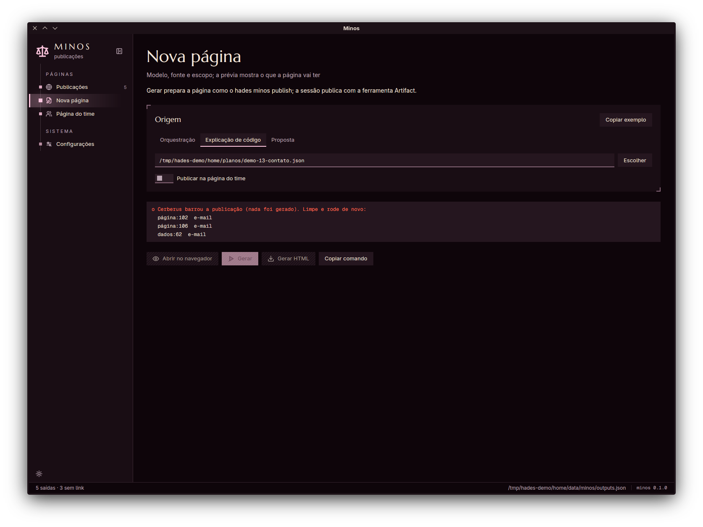
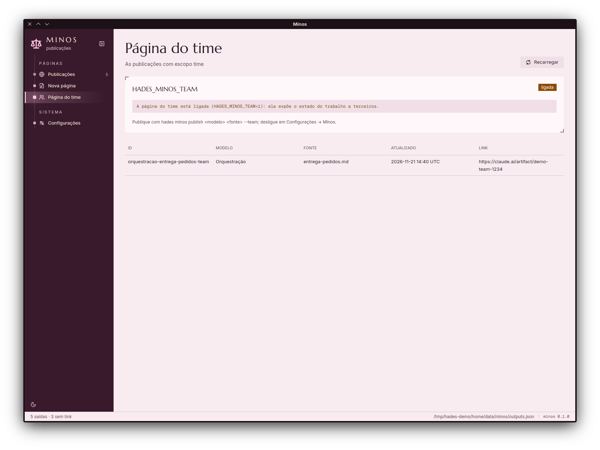
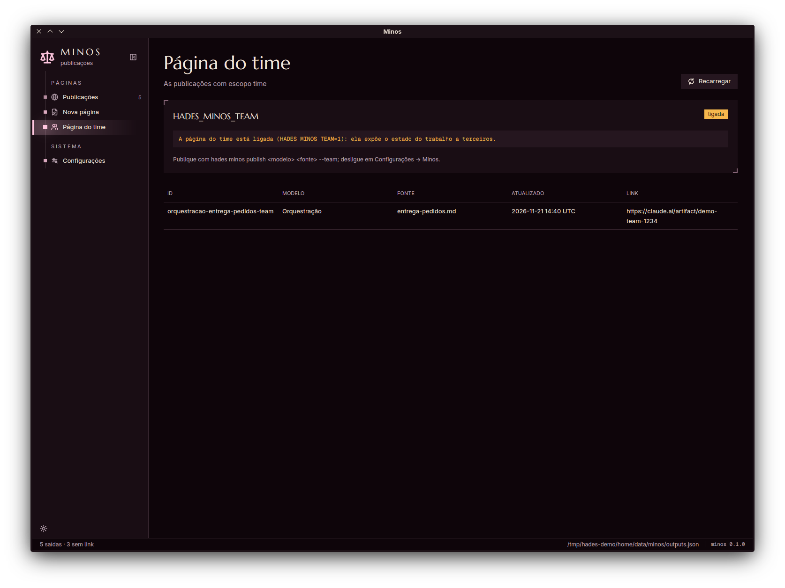
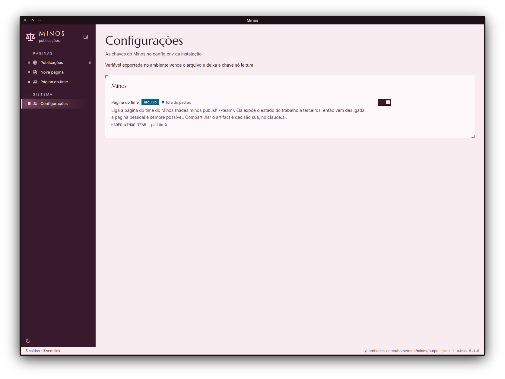
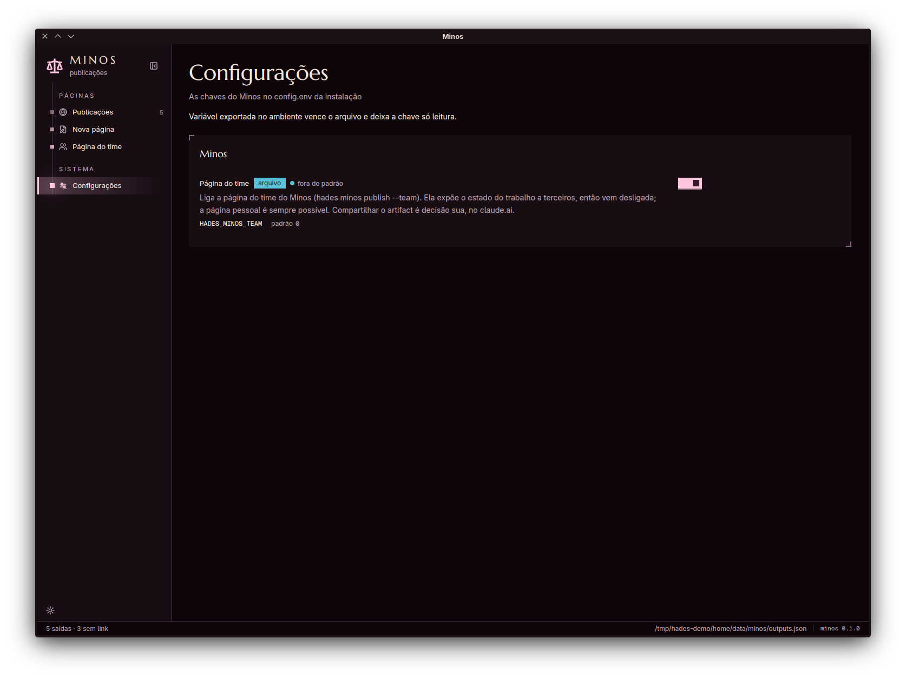

# Minos

Minos: ferramenta do Hades, reescrita em Rust.

## Crates

- `crates/minos-core`: regra de negócio, sem interface.
- `crates/minos-cli`: binário `minos` (clap).
- `crates/minos-app`: view gpui exportada e binário `minos-app`.

## Estado

- **CLI:** o binário `minos` cobre os comandos do Minos do Hades (`list`, `schema`, `publish`, `link` e `open`). A paridade com
  a versão em TypeScript roda no CI e trava o merge quando diverge: 166 de 166 casos iguais.
- **App:** o `minos-app` tem as 4 telas (Publicações, Nova página, Página do time e Configurações).
- **Ligar no Hades:** a flag `HADES_MINOS_IMPL` no Hades-Skill, que fará o `hades minos …` chamar o binário `minos`,
  ainda está a caminho. Até lá, o Hades usa a versão em TypeScript.

## Limitações conhecidas

- **X11:** sob X11 (ou Xwayland), a tela às vezes fica no primeiro quadro ("carregando…") depois que os dados já
  chegaram: o estado da view está certo e a janela não repinta. Não aparece no Wayland nativo. O defeito é do backend
  x11 do gpui, e o Minos não tem contorno para ele.

## Capturas

O `minos-app` nos temas claro e escuro. Os dados são fictícios, montados num HOME de exemplo.

| Tela | Claro | Escuro |
| --- | --- | --- |
| Publicações, com o detalhe de uma saída aberto no painel lateral |  |  |
| Nova página, com a prévia de uma proposta |  |  |
| Nova página, com a fonte recusada pelo modelo |  |  |
| Página do time |  |  |
| Configurações |  |  |

## Relação com o Hades-Skill

Faz parte da reescrita em Rust das ferramentas do [Hades-Skill](https://github.com/The-Hades-Organization/Hades-Skill). O Hades-Skill continua sendo a fonte até o corte, quando passa a chamar o binário.

## Licença

MIT. Veja `LICENSE`.
