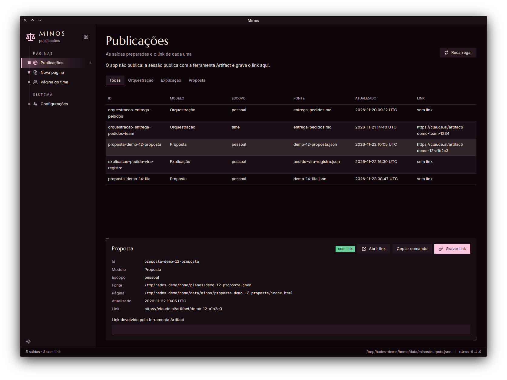
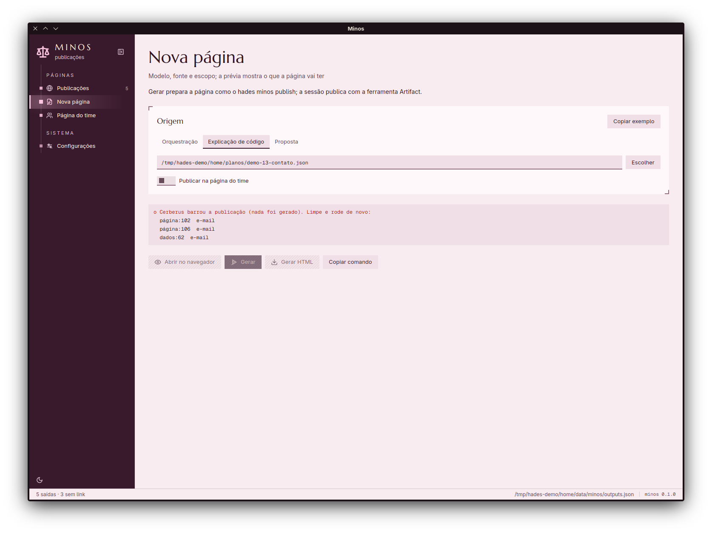

# Minos

Minos: ferramenta do Hades, reescrita em Rust.

## Crates

- `crates/minos-core`: regra de negócio, sem interface.
- `crates/minos-cli`: binário `minos` (clap).
- `crates/minos-app`: view gpui exportada e binário `minos-app`.

## Estado

F0, em construção. Só o esqueleto do workspace existe; nada da ferramenta foi portado ainda.

## Capturas

O `minos-app` nos temas claro e escuro. Os dados são fictícios, montados num HOME de exemplo.

| Tela | Claro | Escuro |
| --- | --- | --- |
| Publicações, com o detalhe de uma saída aberto |  |  |
| Nova página, com a prévia de uma proposta |  |  |
| Nova página, com a fonte recusada pelo modelo |  |  |
| Página do time |  |  |
| Configurações |  |  |

## Relação com o Hades-Skill

Faz parte da reescrita em Rust das ferramentas do [Hades-Skill](https://github.com/The-Hades-Organization/Hades-Skill). O Hades-Skill continua sendo a fonte até o corte, quando passa a chamar o binário.

## Licença

MIT. Veja `LICENSE`.
